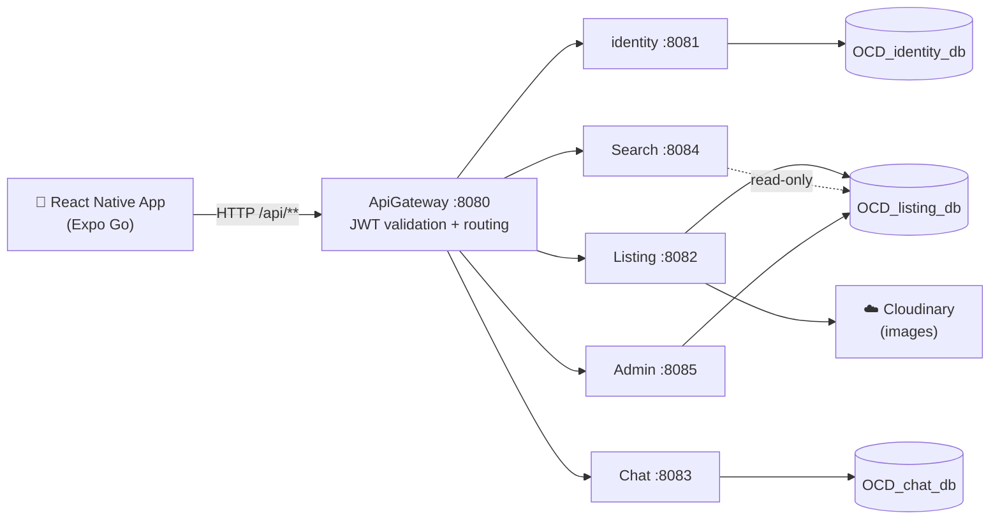

# OnCampus-Deals

**GitHub Repository:** [kodercrish/OnCampus-Deals](https://github.com/kodercrish/OnCampus-Deals)

## Project Overview

**OnCampus Deals** is a microservices-based marketplace application tailored for university campuses. It gives students a secure and convenient platform to buy, sell, and trade items with their peers, with in-app chat, listing management, and fast item discovery.

---

## 🚀 Features

*   **User Authentication**: Secure signup and login with JWT-based sessions.
*   **Browse Feed**: A dynamic feed displaying active listings from across the campus.
*   **Advanced Search**: Filter items by category or price range, or search by keyword.
*   **Create Listings**: Sellers can post items with titles, descriptions, prices, and images (stored on Cloudinary).
*   **Listing Management**: Edit or delete your listings and mark items as "Sold" or "Unavailable".
*   **Chat**: Buyers can message sellers directly within the app.
*   **Admin Moderation**: Admins can view all listings, delete listings, and mark them unavailable.

---

## 🏗️ Architecture

The project follows a decoupled microservice architecture: a Spring Boot backend behind an API gateway, and a React Native (Expo) mobile frontend.



### Backend (Microservices)

| Service | Directory | Port | Gateway route | Description |
| :--- | :--- | :--- | :--- | :--- |
| **ApiGateway** | `backend/ApiGateway` | 8080 | — | Single entry point for all client requests. Validates JWTs and routes to internal services using **Spring Cloud Gateway**. |
| **Identity Service** | `backend/identity` | 8081 | `/api/auth/**` (public) | User registration, login, and JWT issuance. |
| **Listing Service** | `backend/Listing` | 8082 | `/api/listing/**` (JWT) | Core marketplace logic: creating, editing, fetching, and deleting listings. Integrates with **Cloudinary** for images. |
| **Chat Service** | `backend/Chat` | 8083 | `/api/chat/**` (JWT) | Messaging between buyers and sellers. |
| **Search Service** | `backend/Search` | 8084 | `/api/search/**` (JWT) | Search and filtering by keyword, category, and price range. |
| **Admin Service** | `backend/Admin` | 8085 | `/api/admin/**` (JWT) | Moderation: fetch all listings, delete listings, mark listings unavailable. |

### Tech Stack

| Layer | Technologies |
| :--- | :--- |
| **Backend** | Java 21, Spring Boot 3.5.7, Spring Cloud 2025.0.0 (Gateway), Spring Security, Spring Data JPA, jjwt 0.11.5, Cloudinary Java SDK |
| **Database** | MySQL |
| **Build** | Gradle wrapper 8.14.3 (per service) |
| **Frontend** | React Native 0.81, React 19.1, Expo SDK 54, TypeScript |
| **State / Data** | Redux Toolkit, RTK Query |
| **Navigation** | React Navigation (Native Stack & Bottom Tabs) |

---

## 🛠️ Setup Instructions

### Prerequisites

1.  **JDK 21**
2.  **Node.js** (LTS) and **npm**
3.  **MySQL Server** running locally
4.  A **Cloudinary** account (for listing images)
5.  **Expo Go** app on your phone (Android or iOS, supporting SDK 54). Your phone and computer must be on the **same Wi-Fi network**.

### 1. Find Your LAN IP

The phone reaches the backend over your local network, so `localhost` will not work from the device. Find your computer's LAN IP (e.g. `192.168.1.20`):

```bash
# Linux
hostname -I
# macOS
ipconfig getifaddr en0
# Windows
ipconfig
```

You can also run the frontend once (`npm start`) and read the IP shown in the Expo output.

### 2. Create the Databases

```sql
CREATE DATABASE IF NOT EXISTS OCD_identity_db;
CREATE DATABASE IF NOT EXISTS OCD_listing_db;
CREATE DATABASE IF NOT EXISTS OCD_chat_db;
```

*   Database names are case sensitive.
*   `identity` also uses `createDatabaseIfNotExist=true`, so its database is created automatically if missing.
*   **Search** and **Admin** share `OCD_listing_db` with `ddl-auto=none`, so they never create tables. Start the **Listing** service at least once first so it creates the schema.

### 3. Configure the Backend

`application.properties` is gitignored. In **each of the 6 services**, copy the example file and fill it in:

```bash
for s in Admin ApiGateway Chat identity Listing Search; do
  cp backend/$s/src/main/resources/application-example.properties \
     backend/$s/src/main/resources/application.properties
done
```

Then set the required keys (placeholders shown, never commit real values):

| Service | Key(s) | Notes |
| :--- | :--- | :--- |
| All except ApiGateway | `spring.datasource.username`, `spring.datasource.password` | Your MySQL credentials. |
| ApiGateway | `jwt.secret=<your-secret>` | Must be **identical** to identity's `app.secret.key`, at least 32 bytes. |
| ApiGateway | `spring.cloud.gateway.routes[*].uri` | Replace every `[write your device specific url here]` with `localhost` or your LAN IP. |
| identity | `app.secret.key=<your-secret>` | Same value as `jwt.secret`, at least 32 bytes. |
| identity | `app.jwt.expiration` | Optional. Token lifetime in ms (default in example: 7 days). |
| Listing | `cloudinary.cloud_name`, `cloudinary.api_key`, `cloudinary.api_secret` | From your Cloudinary dashboard. |

### 4. Run the Backend

**Recommended:** from the repository root, start all 6 backend services:

```bash
./start-all.sh
```

*   Starts Admin, ApiGateway, Chat, identity, Listing, and Search in the background (the frontend is started separately).
*   Logs go to `logs/<Service>.log`; PIDs are saved to `service_pids.txt`.

Stop everything with:

```bash
./stop-all.sh
```

This stops each PID in `service_pids.txt` and deletes the file. If services are still running (e.g. the PID file is missing), check what is listening on ports 8080–8085 (`lsof -i :8080-8085`) or use `pkill -f 'java|expo'` as a fallback.

**OR**

Run each service manually in its own terminal:

```bash
cd backend/Listing
./gradlew bootRun
```

Repeat for `identity`, `Chat`, `Search`, `Admin`, and finally `ApiGateway`. (Run Listing before Search and Admin on first setup.)

### 5. Run the Frontend

```bash
cd frontend
cp .env.example .env
```

Edit `.env` so `API_BASE` points to the gateway on your LAN IP, including the `/api` suffix:

```env
API_BASE=http://<LAN-IP>:8080/api
```

Then install and start:

```bash
npm install
npm start      # runs expo start on port 8086
```

Scan the QR code in the terminal with **Expo Go** on your phone.

---

## 🧪 Testing

Unit and integration tests live in `src/test` of each service. The controller tests run with `spring.profiles.active=test`, but `application-test.properties` is **not committed**. Before running tests, create `src/test/resources/application-test.properties` in each service that needs it, providing:

*   a test datasource (e.g. an H2 in-memory database for services that include H2 as a test dependency, or a separate MySQL test database),
*   any secrets the service reads (e.g. `app.secret.key` for identity, `jwt.secret` for ApiGateway, dummy `cloudinary.*` values for Listing).

Run tests for one service:

```bash
cd backend/<Service>
./gradlew clean test
```

**OR**

Run all services' tests from the root:

```bash
./run-all-tests.sh
```

Tests run in the background; follow progress in `test_logs/<Service>_test.log` (e.g. `tail -f test_logs/Listing_test.log`).

---

## ⚠️ Known Limitations

*   Admin routes (`/api/admin/**`) are JWT-protected at the gateway but **not yet role-checked**, so any authenticated user can currently call them.

---

## 📄 License

Not specified.
